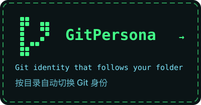
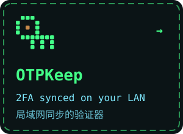
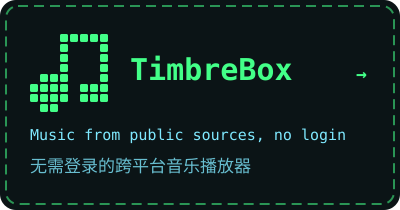

<picture>
  <source media="(prefers-color-scheme: dark)" srcset="assets/banner-dark.svg" />
  <source media="(prefers-color-scheme: light)" srcset="assets/banner-light.svg" />
  
</picture>

<picture>
  <source media="(prefers-color-scheme: dark)" srcset="assets/terminal-dark.svg" />
  <source media="(prefers-color-scheme: light)" srcset="assets/terminal-light.svg" />
  
</picture>

  <a href="https://github.com/weikxs/gitpersona"><picture>
    <source media="(prefers-color-scheme: dark)" srcset="assets/card-gitpersona-dark.svg" />
    <source media="(prefers-color-scheme: light)" srcset="assets/card-gitpersona-light.svg" />
    
  </picture></a>
  <a href="https://github.com/weikxs/otpkeep"><picture>
    <source media="(prefers-color-scheme: dark)" srcset="assets/card-otpkeep-dark.svg" />
    <source media="(prefers-color-scheme: light)" srcset="assets/card-otpkeep-light.svg" />
    
  </picture></a>
  <a href="https://github.com/weikxs/timbrebox"><picture>
    <source media="(prefers-color-scheme: dark)" srcset="assets/card-timbrebox-dark.svg" />
    <source media="(prefers-color-scheme: light)" srcset="assets/card-timbrebox-light.svg" />
    
  </picture></a>

<picture>
  <source media="(prefers-color-scheme: dark)" srcset="assets/footer-dark.svg" />
  <source media="(prefers-color-scheme: light)" srcset="assets/footer-light.svg" />
  
</picture>
